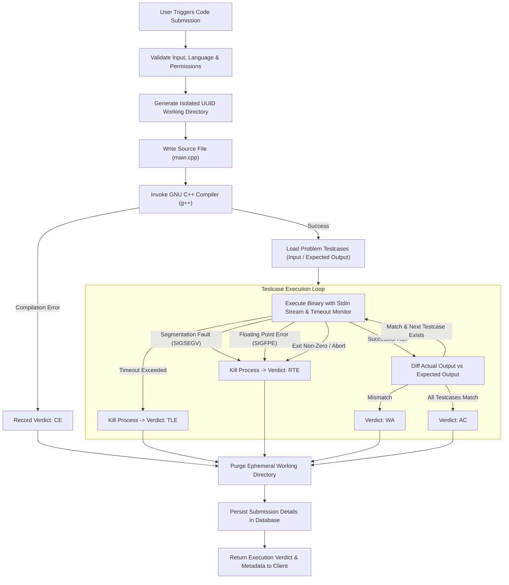
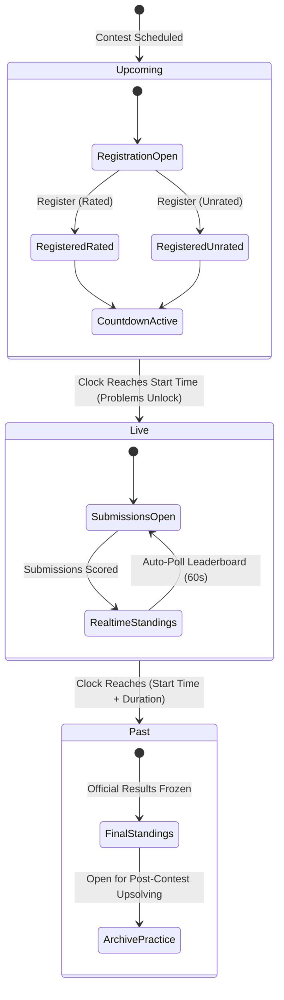
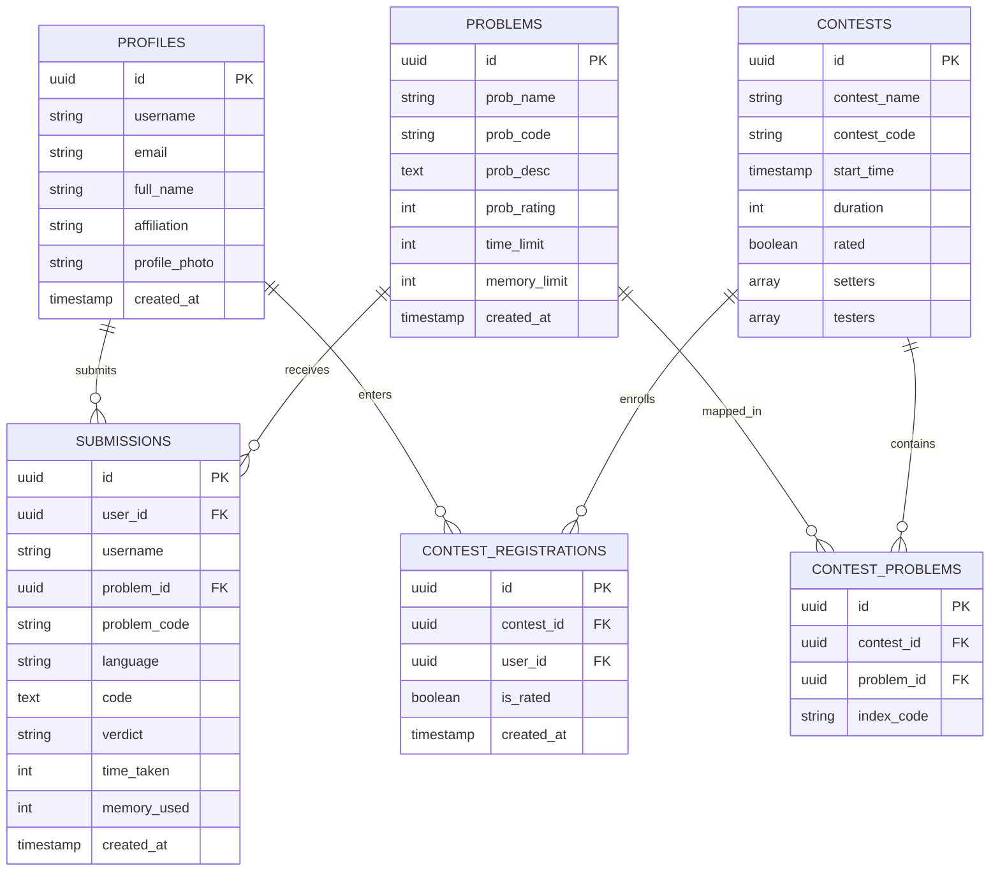

# Code-It-Up ⚡

> A high-performance competitive programming and algorithmic contest platform featuring in-browser code execution, an automated sandboxed judge engine, and real-time ICPC-style contest leaderboards.

---

## 📌 Overview

**Code-It-Up** is a full-stack algorithmic challenge platform inspired by platforms like Codeforces and AtCoder, paired with a tactile, retro-brutalist "blueprint" visual design system. The system provides a complete workflow for competitive programmers and contest organizers: from problem browsing and real-time testcase execution to synchronized contest rounds and dynamic live standings.

---

## 🏛️ System Architecture

The platform follows a modular layered architecture dividing client interactions, service orchestration, local sandbox execution, and persistent cloud storage.

### High-Level System Architecture Diagram

```mermaid
graph TD
    subgraph ClientLayer["Frontend Client (React 19 + Vite)"]
        UI["Blueprint UI & Monaco Code Editor"]
        State["Auth Context & Router State"]
        Poller["Live Standings Poller & Timers"]
    end

    subgraph ServiceLayer["Application Server (Node.js / Express)"]
        AuthSvc["Authentication & Session Manager"]
        ContestSvc["Contest & Registration Orchestrator"]
        JudgeSvc["Code Execution & Submission Pipeline"]
        StandingsEngine["ICPC Standings Aggregation Engine"]
    end

    subgraph SandboxLayer["Execution Sandbox (Local Environment)"]
        Compiler["GNU C++ Compiler (g++)"]
        ProcessRunner["Process Execution & Limits Monitor"]
        TestVerifier["Testcase Batch Verifier"]
        VerdictClassifier["Verdict Classifier (Signals & Exits)"]
    end

    subgraph DataLayer["Persistence Layer (Supabase / PostgreSQL)"]
        UsersDB[("Profiles & Credentials")]
        ProblemsDB[("Problems & Specifications")]
        ContestsDB[("Contests & Registrations")]
        SubmissionsDB[("Submissions Log")]
    end

    UI -->|Interactive State & Action Dispatch| AuthSvc
    UI -->|Contest Interaction| ContestSvc
    UI -->|Run / Submit Solutions| JudgeSvc
    Poller -->|Fetch Dynamic Leaderboard| StandingsEngine

    AuthSvc <-->|User Records| UsersDB
    ContestSvc <-->|Contests & Enrollment| ContestsDB
    JudgeSvc <-->|Log Verdicts & Metadata| SubmissionsDB
    JudgeSvc <-->|Fetch Limits & Problem Specs| ProblemsDB
    StandingsEngine <-->|Read Registrations & Submissions| ContestsDB
    StandingsEngine <-->|Read Submissions within Window| SubmissionsDB

    JudgeSvc -->|Spawn Isolated Sandbox| Compiler
    Compiler -->|Output Binary| ProcessRunner
    ProcessRunner -->|Feed Inputs| TestVerifier
    TestVerifier -->|Process Signals & Diff Output| VerdictClassifier
    VerdictClassifier -->|Final Verdict (AC, WA, TLE, etc.)| JudgeSvc
```

---

## ⚙️ Implemented Modules & Features

### 1. User Identity & Authentication
- **Secure Authentication:** Session handling backed by JSON Web Tokens and encrypted password hashing via bcrypt.
- **Browser Credential Management:** Fully compliant standard credential metadata (`autocomplete` attributes) enabling native browser password manager save/update prompts.
- **Persistent Remember Me:** Local storage persistence for remember-me credentials across sessions with automatic form pre-filling.

---

### 2. Problemset & Algorithmic Repository
- **Categorized Problem Catalog:** Searchable and filterable problem repository with difficulty rating badges and tags.
- **Problem Statement Presentation:** Formatted problem views including input/output specifications, mathematical constraints, and sample testcases with copyable snippets.
- **Resource Constraints:** Defined execution time limits (in milliseconds) and memory thresholds per challenge.

---

### 3. Online Judge & Execution Engine



- **Dual-Mode Execution:**
  - **Run Mode:** Compiles and executes code against custom user-defined inputs without altering global submission stats.
  - **Submit Mode:** Judges the solution against the full batch test suite on disk, assigning official verdicts.
- **Precise Verdict Classifier:**
  - `AC` (Accepted): Solution passes all testcases within the time limit.
  - `WA` (Wrong Answer): Solution produces an output mismatch against canonical answers.
  - `TLE` (Time Limit Exceeded): Process exceeds the execution window and is cleanly terminated.
  - `CE` (Compilation Error): Compiler flags syntax errors or build issues.
  - `RTE` (Runtime Error): Catches `SIGSEGV`, `SIGABRT`, `SIGFPE`, and non-zero exit codes.

---

### 4. Contest Organization & Lifecycle



- **Dynamic Lifecycle Management:** Contests transition through three states:
  - **Upcoming:** Registration portal open; real-time countdown timer active; problems locked.
  - **Live:** Instant problem release upon start time; submission processing enabled; live standings updating.
  - **Past:** Official results archived; problems unlocked for ongoing practice and upsolving.
- **Participation Modes:** Allows users to enroll with either **Rated** (alters rating calculations) or **Unrated** (casual practice) status.

---

### 5. ICPC-Style Standings & Leaderboard System

The standings module calculates contest rankings following the international ICPC standard.

```mermaid
graph LR
    subgraph InputData["Contest Data"]
        Registrations["Contest Registrations (Rated & Unrated)"]
        TimeBounds["Contest Time Window [T_start, T_end]"]
        Submissions["Contest Problem Submissions"]
    end

    subgraph EvaluationPipeline["Standings Aggregation Pipeline"]
        Filter["Window Filter (Discard Submissions Outside Contest)"]
        UserGroup["Group Submissions by Participant"]
        ProblemEval["Problem Evaluation: First AC Detection & Pre-AC Wrong Attempts"]
        ScoreCalc["Calculate Solved Count & Penalty: T_solve + 20 × WrongAttempts"]
        SortRanks["Sort: Solved (Descending) -> Penalty (Ascending)"]
        AssignRanks["Assign Ranks with Duplicate-Score Tie Resolution"]
    end

    subgraph OutputView["Leaderboard Interface"]
        Table["Interactive Standings Table with Gold/Silver/Bronze Medals"]
    end

    InputData --> Filter
    Filter --> UserGroup
    UserGroup --> ProblemEval
    ProblemEval --> ScoreCalc
    ScoreCalc --> SortRanks
    SortRanks --> AssignRanks
    AssignRanks --> OutputView
```



- **Scoring Formula:**
  $$\text{Problem Penalty} = \text{Solve Time (minutes)} + (20 \times \text{Wrong Submissions Before First AC})$$
  $$\text{Total Penalty} = \sum_{\text{Solved Problems}} \text{Problem Penalty}$$
- **Key Standings Capabilities:**
  - **Registration-Bound Participant Display:** All registered contenders appear, including those with zero solves.
  - **Live Standings Polling:** Background auto-refresh polling every 60 seconds during live rounds, supplemented with an instant manual sync trigger.
  - **Visual Distinction:** Highlights the authenticated user's row (`YOU` indicator), marks unrated participants, and renders gold, silver, and bronze podium badges.
  - **Contextual Problem Links:** Header column indicators link directly to problem statements for quick navigation.

---

### 6. Relational Data Architecture

The persistence model establishes clear relational boundaries between users, problems, contest fixtures, and execution history.



---

## 🎨 Visual Identity & Design System

The frontend implements a custom **Blueprint / Tactical Brutalist** design philosophy:
- **Canvas Palette:** Warm, tactile cream background (`#EDE8DC`) paired with off-white panel surfaces (`#FAF7F0`).
- **Border Treatment:** Confident `2px solid #17181A` ink borders across components, buttons, and input fields.
- **Graphic Accents:** Technical grid textures, annotation markers with connector lines, and accent colors (Lime `#E7F0A0` for success/active states, Coral `#F3A79A` for errors/unsolved states).
- **Typography:** Blocky monospace typeface (`Space Mono` / `JetBrains Mono`) for metrics, titles, and terminal data, balanced by clean grotesque sans-serif for body descriptions.

---

## 🛠️ Technology Stack

| Layer | Technologies |
|---|---|
| **Frontend Framework** | React 19, Vite, React Router v7 |
| **Styling & Icons** | Tailwind CSS v4, Lucide React, Custom Blueprint Tokens |
| **Code Editor** | Monaco Editor (`@monaco-editor/react`) |
| **Backend Runtime** | Node.js, Express (ES Modules) |
| **Language Sandboxing** | Child process execution, GCC/G++ Toolchain |
| **Database & Auth** | Supabase (PostgreSQL), JWT, bcrypt |
| **Form Management** | React Hook Form, React Toastify |

---

## 🚀 Local Development Setup

### Prerequisites
- **Node.js** (v18 or higher)
- **C++ Compiler** (`g++`) accessible in your system's PATH
- **Supabase Project** with relational schema migrations applied

### 1. Repository Setup
```bash
git clone https://github.com/Master-Bruce-Wayne/Code-It-Up.git
cd Code-It-Up
```

### 2. Backend Configuration
Create an environment file inside the `backend/` directory:
```bash
cd backend
npm install
```
Configure environment variables:
- `PORT`: Server port
- `FRONTEND_URL`: Client application host origin for CORS validation
- `JWT_SECRET`: Secret key for session token signing
- `SUPABASE_URL`: Supabase project URL
- `SUPABASE_ANON_KEY` / `SUPABASE_SERVICE_ROLE_KEY`: Supabase API credentials

Start the backend service:
```bash
npm run dev
```

### 3. Frontend Configuration
In a separate terminal:
```bash
cd frontend
npm install
```
Configure environment variables:
- `VITE_API_BASE_URL`: Base URL where the backend application server is hosted

Start the development server:
```bash
npm run dev
```
Build for production:
```bash
npm run build
```

---

## 📄 License
This project is licensed under the ISC License.
