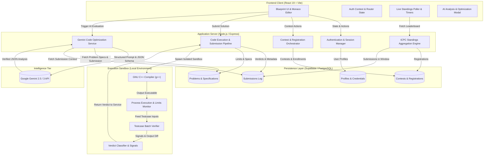
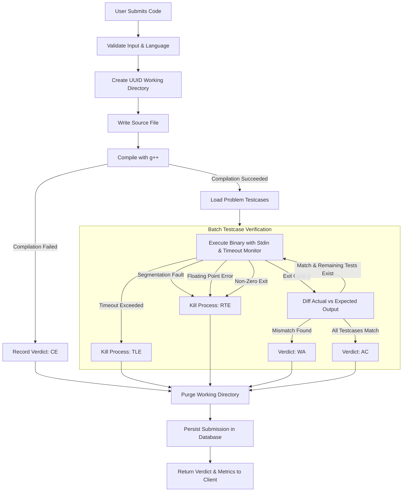
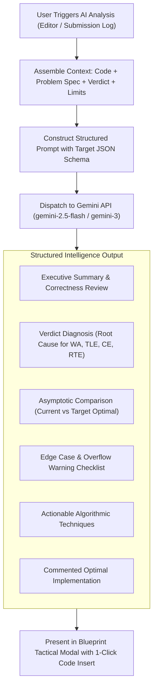
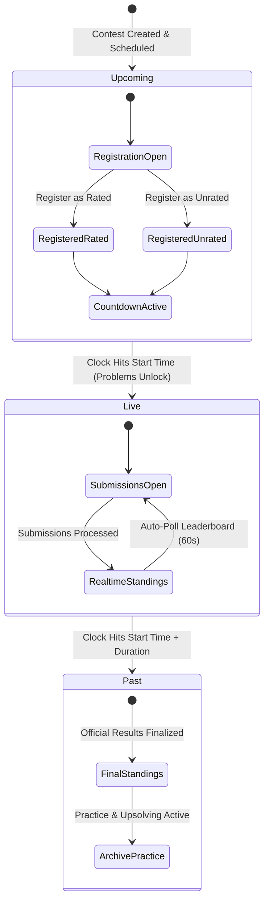
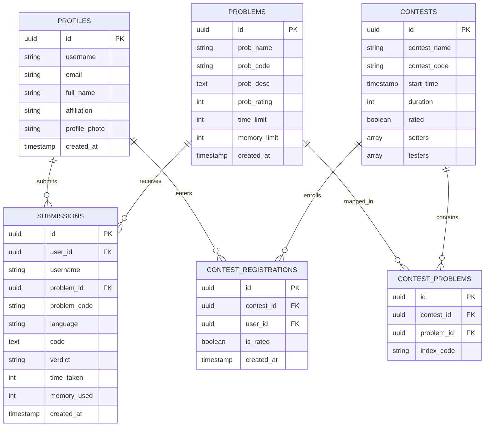

<div align="center">

# ⚡ Code-It-Up

**A Modern, High-Performance Competitive Programming & Algorithmic Contest Platform**

[](https://react.dev/)
[](https://vitejs.dev/)
[](https://tailwindcss.com/)
[](https://nodejs.org/)
[](https://expressjs.com/)
[](https://supabase.com/)
[](https://ai.google.dev/)
[](https://gcc.gnu.org/)
[](LICENSE)

<br/>

<p align="center">
  <b>In-Browser Code Editor</b> • <b>Local Sandboxed Judge</b> • <b>Real-Time ICPC Standings</b> • <b>AI Code Analysis (Gemini)</b> • <b>Retro-Brutalist Blueprint UI</b>
</p>

</div>

---

## 📖 Table of Contents

- [Overview](#-overview)
- [Key Features](#-key-features)
- [System Architecture](#-system-architecture)
  - [High-Level Architecture](#1-high-level-architecture)
  - [Online Judge & Execution Pipeline](#2-online-judge--execution-pipeline)
  - [AI Code Analysis & Optimization Pipeline (Gemini)](#3-ai-code-analysis--optimization-pipeline-gemini)
  - [Contest State Machine](#4-contest-state-machine)
  - [ICPC Standings Aggregation Engine](#5-icpc-standings-aggregation-engine)
  - [Relational Data Architecture](#6-relational-data-architecture)
- [Design System & Aesthetics](#-design-system--aesthetics)
- [Technology Stack](#-technology-stack)
- [Local Development Setup](#-local-development-setup)
- [Contributing & License](#-contributing--license)

---

## 📌 Overview

**Code-It-Up** is a full-featured competitive programming platform designed for problem setters, contest organizers, and competitive coders. Engineered with inspiration from industry standards such as Codeforces and AtCoder, the platform pairs an automated local judge engine with a tactile, technical **Blueprint / Retro-Brutalist** design aesthetic and Google Gemini AI assistance.

Users can browse categorized algorithmic challenges, test solutions against custom testcases in an integrated Monaco code editor, analyze code with AI for time complexity and algorithmic optimization, compete in scheduled rounds with countdown synchronization, and track live standings calculated via international ICPC rules.

---

## 🚀 Key Features

- **⚡ In-Browser Monaco Code Editor**: Syntax highlighting, auto-indentation, and multi-language foundations.
- **🤖 AI-Driven Code Analysis & Optimization**: Integrated Google Gemini API delivers structured verdict diagnosis, time & space asymptotic evaluation, edge-case warning checklists, and fully commented optimal code.
- **🛡️ Sandboxed Online Judge**: Automatic compilation, process supervision with timeout monitoring, and batch testcase validation on native disk storage.
- **⏱️ Contest Lifecycle Automation**: Three-stage progression (Upcoming, Live, Past) with automated problem release timers and problem locking.
- **🏆 ICPC-Standard Standings**: Real-time rank calculation combining problem solves with minute-based penalties and wrong-attempt multipliers.
- **🔄 Live Auto-Syncing**: 60-second polling intervals during active rounds plus on-demand manual sync for instant leaderboard refresh.
- **🔒 Browser Credential Integration**: Native `autocomplete` attributes support browser password managers alongside persistent "Remember Me" credentials.
- **🎯 Rated & Unrated Tracks**: Flexible participation enrollment allowing competitive users to track rating changes while casual participants upsolve without rating pressure.
- **📊 Comprehensive Submission Auditing**: Transparent execution telemetry recording language, execution time, memory usage, and precise OS signal-level verdicts.

---

## 🏛️ System Architecture

The platform separates concerns across four distinct architectural tiers: the client presentation tier, the application routing & business logic tier, the local sandboxed judge tier, and the cloud relational & AI intelligence tier.

### 1. High-Level Architecture



---

### 2. Online Judge & Execution Pipeline

When a user submits code, the submission pipeline creates an ephemeral directory, compiles the source code, and feeds inputs from disk into the running process while monitoring time limits and operating system signals.



#### Verdict Classification Reference

| Verdict | Meaning | Underlying Cause |
|---|---|---|
| **AC** | Accepted | Solution executed within time limit and output matched all canonical outputs byte-for-byte. |
| **WA** | Wrong Answer | Solution terminated normally but produced incorrect output on one or more testcases. |
| **TLE** | Time Limit Exceeded | Execution duration exceeded the problem's time limit threshold; process terminated by judge. |
| **CE** | Compilation Error | The GNU C++ compiler emitted non-zero exit code due to syntax or linking errors. |
| **RTE** | Runtime Error | Process terminated abnormally (`SIGSEGV` segmentation fault, `SIGFPE` arithmetic fault, `SIGABRT`). |

---

### 3. AI Code Analysis & Optimization Pipeline (Gemini)

The AI engine analyzes submitted solutions and code snippets using Google's Gemini models through `@google/genai` structured outputs, providing deterministic, parseable algorithmic feedback:



---

### 4. Contest State Machine

Contest progression is governed by strict wall-clock time boundaries. The frontend and backend synchronize on UTC timestamps to manage registrations, problem visibility, and standings finalization.



---

### 5. ICPC Standings Aggregation Engine

The standings service processes all activity within the contest window, enforcing fair competition rules:

```mermaid
flowchart LR
    subgraph InputData["Contest Data"]
        Registrations["Contest Registrations"]
        TimeBounds["Contest Window: T_start to T_end"]
        Submissions["Contest Submissions"]
    end

    subgraph EvaluationPipeline["Standings Engine"]
        Filter["Filter Submissions to Contest Window"]
        UserGroup["Group Submissions by Registered User"]
        ProblemEval["Detect First AC & Count Pre-AC Wrongs"]
        ScoreCalc["Calculate Penalty: Time + 20m x Wrongs"]
        SortRanks["Sort: Solved Descending, Penalty Ascending"]
        AssignRanks["Assign Ranks with Duplicate-Score Ties"]
    end

    subgraph OutputView["Leaderboard"]
        Table["Render Standings Table & Podium Medals"]
    end

    InputData --> Filter
    Filter --> UserGroup
    UserGroup --> ProblemEval
    ProblemEval --> ScoreCalc
    ScoreCalc --> SortRanks
    SortRanks --> AssignRanks
    AssignRanks --> OutputView
```



$$\text{Problem Penalty} = \text{Solve Time (minutes from start)} + (20 \times \text{Wrong Submissions Before First AC})$$

$$\text{Total Contest Penalty} = \sum_{p \in \text{Solved Problems}} \text{Penalty}(p)$$

- **Registration Gate:** Only registered contestants appear in the official leaderboard; users with zero solves remain listed.
- **Time Boundary Enforcement:** Submissions before the official start or after the contest duration expires are ignored in the calculation.
- **Tie Resolution:** Participants with identical solve counts and identical penalties share the same rank.

---

### 6. Relational Data Architecture

The underlying PostgreSQL database hosted on Supabase enforces referential integrity across the contest platform:



---

## 🎨 Design System & Aesthetics

Code-It-Up adopts an intentional **Technical Blueprint & Retro-Brutalist** visual system:

- **Warm Paper Canvas**: `#EDE8DC` background paired with `#FAF7F0` card surfaces, evoking an annotated engineering drawing.
- **Architectural Borders**: Confident `2px solid #17181A` ink strokes on all interactive cards, inputs, and tables with zero blurry drop shadows.
- **Hard-Offset Accents**: Hard-offset solid blocks (`4px 4px 0px 0px #17181A`) provide tactile depth on button clicks and hover states.
- **Technical Typography**: Monospace fonts (`Space Mono`, `JetBrains Mono`) dominate data headers, stats, code snippets, and button actions, supported by clean sans-serif for reading comfort.
- **Annotation Markers**: Grid intersection anchors and connector lines signify live metrics and layout sections.

---

## 🛠️ Technology Stack

| Layer | Technology | Purpose |
|---|---|---|
| **Frontend Core** | React 19, Vite | Single-page application rendering with optimized module bundling. |
| **Routing** | React Router DOM v7 | Dynamic client-side routing and tab coordination. |
| **Styling** | Tailwind CSS v4, Lucide React | Utility-first styling with custom blueprint color tokens and iconography. |
| **Editor** | Monaco Editor | In-browser C++ code authoring environment. |
| **AI Integration** | Google GenAI SDK (`@google/genai`) | Code complexity evaluation, root-cause diagnosis & optimization suggestions. |
| **Backend Core** | Node.js, Express (ESM) | Non-blocking API server and process coordinator. |
| **Compiler & Judge** | GCC / G++ (C++20) | Native machine code compilation and sandboxed execution. |
| **Database** | Supabase (PostgreSQL) | Relational database with ACID transactions and schema integrity. |
| **Auth & Security** | JWT, bcrypt, Cookie Parser | Stateless token issuance with secure cookie storage. |

---

## 🚀 Local Development Setup

### Prerequisites
- **Node.js** (v18.0.0 or later)
- **C++ Compiler** (`g++`) installed and added to your system environment variables (`PATH`)
- **Git**

### 1. Clone the Repository
```bash
git clone https://github.com/Master-Bruce-Wayne/Code-It-Up.git
cd Code-It-Up
```

### 2. Configure & Run Backend
```bash
cd backend
npm install
```
Configure your environment variables in `backend/.env`:
```env
PORT=3000
FRONTEND_URL=http://localhost:5173
JWT_SECRET_KEY=your_jwt_secret_key
SUPABASE_URL=your_supabase_project_url
SUPABASE_ANON_KEY=your_supabase_anon_key
SUPABASE_SERVICE_ROLE_KEY=your_supabase_service_role_key

# Gemini AI API Configuration
GEMINI_API_KEY=your_gemini_api_key
GEMINI_MODEL=gemini-2.5-flash
```
Launch the backend server:
```bash
npm run dev
```

### 3. Configure & Run Frontend
In a new terminal window:
```bash
cd frontend
npm install
```
Configure your client environment in `frontend/.env`:
```env
VITE_API_BASE_URL=http://localhost:3000/api/v1
```
Start the frontend development server:
```bash
npm run dev
```

---

## 📄 License

This project is licensed under the **ISC License**.
