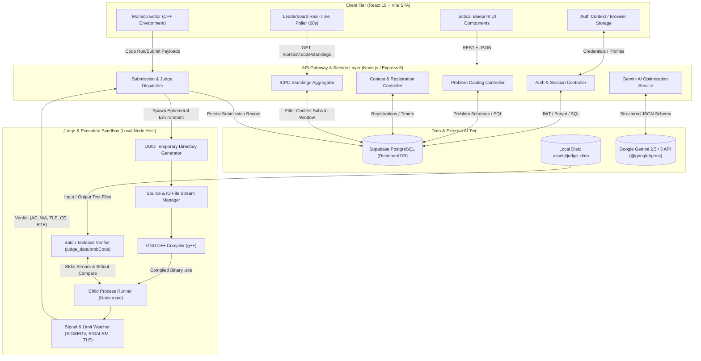
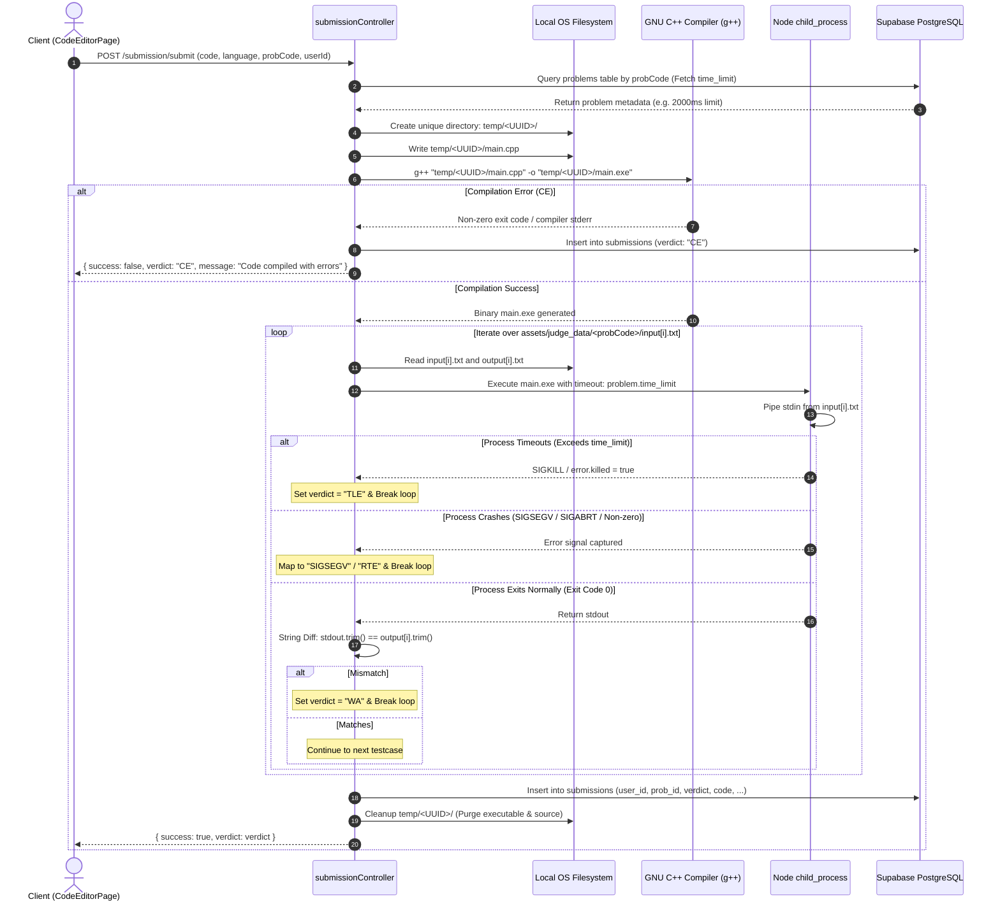
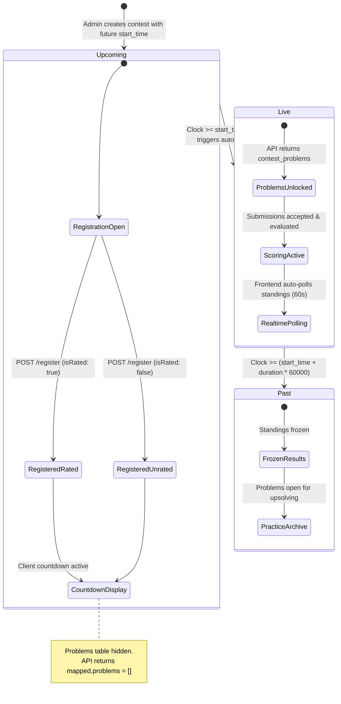
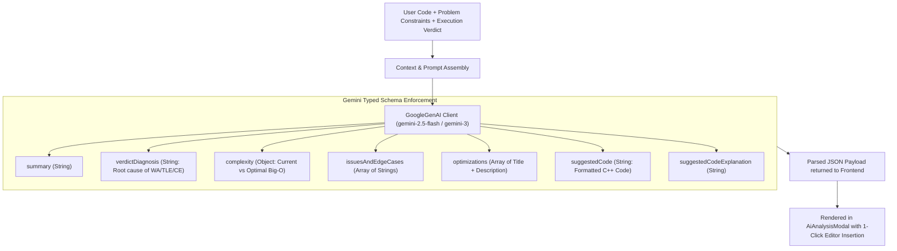
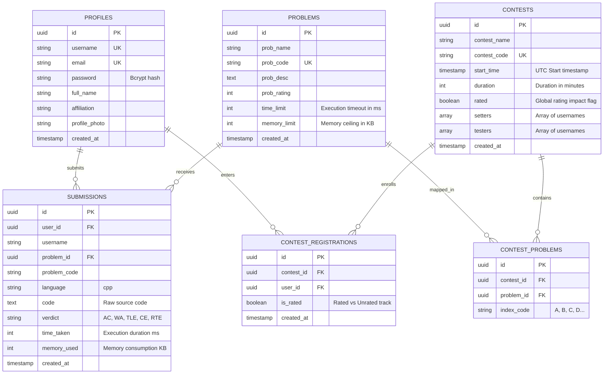

# Code-It-Up: Comprehensive System Architecture & Deep Technical Specification

> **Document Type:** System Architecture & Technical Deep-Dive  
> **Platform:** Code-It-Up (Competitive Programming & Online Judge Ecosystem)  
> **Target Audience:** Core Engineers, System Architects, Technical Interviewers, and Contributors  
> **Date:** November 2026  

---

## Table of Contents
1. [Executive Summary & High-Level Philosophy](#1-executive-summary--high-level-philosophy)
2. [End-to-End System Architecture](#2-end-to-end-system-architecture)
3. [Frontend Architecture & Visual Engineering](#3-frontend-architecture--visual-engineering)
4. [Backend Service Layer & Routing Mechanics](#4-backend-service-layer--routing-mechanics)
5. [Sandboxed Online Judge Engine](#5-sandboxed-online-judge-engine)
6. [Contest Lifecycle & State Machine](#6-contest-lifecycle--state-machine)
7. [ICPC-Standard Standings & Scoring Engine](#7-icpc-standard-standings--scoring-engine)
8. [AI-Driven Code Optimization Engine (Gemini API)](#8-ai-driven-code-optimization-engine-gemini-api)
9. [Relational Data Modeling & Storage Architecture](#9-relational-data-modeling--storage-architecture)
10. [Security, Session Management & Credential Handling](#10-security-session-management--credential-handling)
11. [Failure Modes, Graceful Degradation & Edge Case Handling](#11-failure-modes-graceful-degradation--edge-case-handling)

---

## 1. Executive Summary & High-Level Philosophy

**Code-It-Up** is a full-stack algorithmic challenge and contest execution ecosystem built to mirror the operational rigor of platforms like Codeforces and AtCoder while introducing modern browser capabilities and AI-augmented feedback.

### Architectural Tenets
1. **Low-Latency Determinism:** Code compilation, execution, and testcase verification must run in isolated local environments with deterministic limits on execution time and memory.
2. **Stateless Scalability with Relational Guarantees:** Business logic in Express acts as a stateless coordinator relying on PostgreSQL (via Supabase) for ACID transactions, referential integrity, and cascading guarantees.
3. **Tactile, Blueprint-First Developer Experience:** The user interface departs from generic dashboard templates in favor of a retro-brutalist "tactical blueprint" aesthetic (cream canvas `#EDE8DC`, high-contrast `#17181A` ink strokes, monospace data layouts, and annotation markers).
4. **Resilient AI Augmentation:** Google Gemini models evaluate user code against problem constraints to deliver structured asymptotic complexity breakdowns, logic bug diagnoses, and optimized canonical solutions without crashing or blocking standard platform workflows.

---

## 2. End-to-End System Architecture

The system operates across four primary architectural boundaries: Client Application, Stateless Application Gateway, Isolated Judge Sandbox, and Persistent Cloud Database.



---

## 3. Frontend Architecture & Visual Engineering

### 3.1 Technology Stack & Core Libraries
- **Framework:** React 19 with Vite 7 as the bundler.
- **Routing:** React Router DOM v7 utilizing client-side `<Link>` components to eliminate full-page browser reloads across tabs.
- **Styling:** Tailwind CSS v4 coupled with custom design tokens defined in `frontend/src/index.css`.
- **Editor:** `@monaco-editor/react` configured for C++ with customized line numbers, automatic layout scaling, and JetBrains Mono typography.
- **Forms & Notifications:** `react-hook-form` for controlled client validations; `react-toastify` for asynchronous execution feedback.

### 3.2 Tactical Blueprint Design System
The visual language mimics an annotated architectural drawing or hardware engineering schematic:

```
[ Canvas: #EDE8DC ] -------------------------------------------------+
|  +---------------------------------------------------------------+  |
|  | Card Surface: #FAF7F0 (Border: 2px solid #17181A)              |  |
|  | [■]--[ ANNOTATION MARKER ]                                    |  |
|  |                                                               |  |
|  | Heading: Space Mono / JetBrains Mono (Bold, Uppercase)        |  |
|  | Primary Action Button: #E7F0A0 (Lime Accent, 2px Ink Border)   |  |
|  | Shadow: 4px 4px 0px 0px #17181A (Hard-edge offset block)      |  |
|  +---------------------------------------------------------------+  |
+--------------------------------------------------------------------+
```

- **Color Tokens:**
  - Canvas (`#EDE8DC`): Warm, grainy drafting paper.
  - Surface (`#FAF7F0`): Clean white drawing pane.
  - Ink (`#17181A`): Structural lines, outlines, text, and icons.
  - Accent Lime (`#E7F0A0`): Primary actions, success states, and AC verdicts.
  - Accent Coral (`#F3A79A`): Error alerts, wrong answer (WA), and compilation errors (CE).
  - Accent Blue (`#3169F0`): Navigation indicators and TLE states.
- **Components:**
  - `AnnotationMarker.jsx`: Renders an 8x8px lime indicator block with a 1px connector line and an uppercase status badge.
  - `AiAnalysisModal.jsx`: Full-screen modal housing complexity badges, verdict diagnoses, edge-case alert lists, and an interactive code injection preview.

### 3.3 State Management & Auth Context
The application uses React Context (`frontend/src/context/User.jsx`) for global authentication state:
- Maintains the logged-in user's profile (`_id`, `username`, `email`, `affiliation`).
- Synchronizes with `localStorage.getItem("userData")` on mount to maintain session persistence during page reloads.

---

## 4. Backend Service Layer & Routing Mechanics

The backend is built as an ES Module-based Express 5 application on Node.js (`backend/index.js`).

### 4.1 Modular Route Structure
```
backend/
├── config/
│   ├── supabase.js         # Supabase PostgreSQL client initialization & mock proxy fallback
│   └── gemini.js           # Google GenAI SDK client & structured JSON prompt builder
├── controllers/
│   ├── userController.js       # Register, login, profile management, JWT issuance
│   ├── problemController.js    # Problem creation, lookup by code/ID, difficulty tagging
│   ├── contestController.js    # Contest orchestration, enrollment, ICPC standings aggregation
│   └── submissionController.js # C++ compile/run sandbox, batch judge, AI analysis endpoints
├── routes/
│   ├── userRoute.js        # /api/v1/user
│   ├── problemRoute.js     # /api/v1/problem
│   ├── contestRouter.js    # /api/v1/contest
│   └── submissionRouter.js # /api/v1/submission
├── assets/
│   └── judge_data/         # Canonical input*.txt and output*.txt per problemCode
└── temp/                   # Ephemeral compilation directories (UUID-isolated)
```

### 4.2 Route Precedence & Express Matching
In `backend/routes/contestRouter.js`, the router registers:
1. `/:contestCode/standings`
2. `/:contestCode`
3. `/:contestCode/register`
4. `/:contestCode/registration-status/:userId`

*Architectural Decision:* The specific route `/:contestCode/standings` is declared **before** the parameterized route `/:contestCode`. If declared in reverse, Express would treat the literal string `"standings"` as a problem or contest code parameter, causing route shadowing.

---

## 5. Sandboxed Online Judge Engine

The online judge operates on the host server using Node.js child processes (`child_process.exec`) coupled with direct filesystem streams.

### 5.1 Dual-Mode Operation: Run vs. Submit

| Property | Run Mode (`/submission/run`) | Submit Mode (`/submission/submit`) |
|---|---|---|
| **Purpose** | Developer testing with custom input | Official scoring against canonical test suite |
| **Input Source** | Client-supplied `stdin` text string | Filesystem disk (`assets/judge_data/<probCode>/input*.txt`) |
| **Verification** | Returns raw `stdout` / `stderr` | Diffs actual output against `output*.txt` |
| **Database Effect** | Completely stateless (no records saved) | Writes permanent row to `submissions` table |
| **Contest Effect** | None | Updates penalty, solve count, and standings |

### 5.2 Sandbox Isolation & Execution Flow



### 5.3 Operating System Signal & Runtime Error Mapping
In `backend/controllers/submissionController.js`, runtime errors from the child process execution are classified via `mapRuntimeVerdict(err)`:

```javascript
function mapRuntimeVerdict(err) {
    if (!err) return null;
    if (err.killed && err.signal === "SIGKILL") return "TLE";
    if (err.signal === "SIGSEGV") return "SIGSEGV";
    if (err.signal === "SIGABRT") return "RTE";
    if (err.signal === "SIGFPE")  return "RTE";
    if (err.code !== 0)           return "RTE";
    return "RTE";
}
```

- **SIGKILL:** Triggered by Node when execution duration exceeds `timeout: problem.time_limit`. Correctly labeled as **Time Limit Exceeded (TLE)**.
- **SIGSEGV:** Segmentation fault indicating illegal memory access, out-of-bounds array access, or stack overflow from deep recursion.
- **SIGFPE:** Floating point exception (division by zero, integer modulo by zero).
- **SIGABRT:** Abort signal triggered by assertion failures (`assert()`) or uncaught C++ exceptions.

---

## 6. Contest Lifecycle & State Machine

Contest progression is strictly synchronized using UTC wall-clock timestamps compared against the database properties `start_time` and `duration` (minutes).



### Problem Obfuscation in Upcoming Contests
In `backend/controllers/contestController.js`:
```javascript
const upcoming = new Date(contest.start_time) > new Date();
if (upcoming) {
    mapped.problems = []; // Obfuscate all problems until start_time arrives
}
```
This guarantees that clients inspecting network responses cannot uncover problem names, descriptions, or IDs prior to the official contest start.

---

## 7. ICPC-Standard Standings & Scoring Engine

The standings engine (`getContestStandings`) implements the official **International Collegiate Programming Contest (ICPC)** scoring algorithm.

### 7.1 Mathematical Scoring Formulation

1. **Primary Ranking Key (Descending):** Total number of distinct problems solved with an **Accepted (AC)** verdict within the contest window:
   $$S_u = \sum_{p \in P} \mathbb{I}(\text{solved}(u, p))$$

2. **Secondary Ranking Key (Ascending):** Total accumulated penalty minutes across all solved problems:
   $$\text{Penalty}(u) = \sum_{p \in P_{\text{solved}}} \left( T_{\text{solve}}(u, p) + 20 \times W(u, p) \right)$$
   Where:
   - $T_{\text{solve}}(u, p)$: Minutes elapsed from contest `start_time` until the first AC submission for problem $p$.
   - $W(u, p)$: Number of non-AC submissions (WA, TLE, RTE, etc.) made by user $u$ on problem $p$ **before** the first AC submission.
   - If a problem is never solved with an AC verdict, its wrong attempts incur **zero penalty**.
   - Submissions submitted **after** the first AC on that problem are ignored.

3. **Contest Window Boundary Constraint:**
   $$\text{created\_at} \in [T_{\text{start}}, T_{\text{start}} + \text{duration}]$$

### 7.2 Standings Calculation Pipeline
```
[Database Submissions Table]
        │
        ├── 1. Filter: problem_code LIKE 'CONTEST%'
        ├── 2. Filter: created_at >= contestStart AND created_at <= contestEnd
        ├── 3. Filter: user_id in contest_registrations
        │
        ▼
[In-Memory User State Map]
        │
        ├── Seed all registered users (even with 0 submissions)
        ├── Iterate chronologically sorted submissions:
        │     - If already AC on problem: skip
        │     - If AC: record solve_time_min, mark solved
        │     - If non-AC: increment wrong attempts counter
        │
        ▼
[Score Aggregation]
        │
        ├── Solved Count = Σ (AC problems)
        ├── Total Penalty = Σ (solve_time + 20 * wrong_attempts)
        │
        ▼
[Dual-Key Sort & Rank Assignment]
        │
        ├── Sort: solved DESC, then penalty ASC
        └── Assign Rank: Shared rank on equal (solved, penalty) tuple
```

---

## 8. AI-Driven Code Optimization Engine (Gemini API)

The platform integrates the Google Gemini API using the official `@google/genai` SDK (`backend/config/gemini.js`).

### 8.1 Prompt Engineering & Typed Schema Output
The engine prompts Gemini with the competitive programming context, user source code, problem description, and execution verdict. It forces structured JSON output via `responseMimeType: "application/json"` and `responseSchema`:



### 8.2 Two Ways to Trigger Analysis
1. **Direct from Editor (`CodeEditorPage.jsx`):** Allows coders to analyze unsubmitted or in-progress code. If the user clicks *"Insert in Editor"*, the suggested code is loaded into Monaco.
2. **From Historical Submissions (`SubmissionsPage.jsx`):** Allows contestants to review past submissions and diagnose why a specific submission failed (e.g. integer overflow causing WA on test 14).

---

## 9. Relational Data Modeling & Storage Architecture

The persistence layer is managed in Supabase PostgreSQL with relational constraints and foreign keys.



---

## 10. Security, Session Management & Credential Handling

### 10.1 Password Security & JWT
- **Bcrypt Hashing:** Passwords are never stored in plaintext. They are salted and hashed with 10 salt rounds before storage in `profiles.password`.
- **JWT Issuance:** On login, a JSON Web Token is signed with `JWT_SECRET_KEY` and set as an HTTP-only cookie (`token`).
- **CSRF & Cookie Protection:** Cookies are isolated with `httpOnly: true` to mitigate cross-site scripting (XSS) extraction.

### 10.2 Browser Credential Manager & Autofill Compliance
Both `Login.jsx` and `Register.jsx` implement standard HTML5 `autoComplete` attributes:
- `Login.jsx`: `<form autoComplete="on">`, `autoComplete="username"`, and `autoComplete="current-password"`.
- `Register.jsx`: `autoComplete="new-password"` across password inputs.
- **Security Distinction:** The platform's *"Remember My Username"* checkbox saves **only** the username in `localStorage` under `rememberedUsername`. Passwords are never stored in client storage; password storage is delegated entirely to the browser's native credential manager.

---

## 11. Failure Modes, Graceful Degradation & Edge Case Handling

1. **Missing or Expired Gemini API Key:**
   - If `GEMINI_API_KEY` is not set or rate-limited, `backend/config/gemini.js` logs a warning without crashing the server.
   - The frontend modal displays a clean error banner with diagnostic instructions instead of failing silently.
2. **Supabase Unavailable at Boot:**
   - `backend/config/supabase.js` wraps the client in an ES6 Proxy. If credentials contain placeholders, the server boots successfully but fails gracefully on specific API calls rather than throwing unhandled startup exceptions.
3. **Infinite Loops in User Code:**
   - C++ solutions with while(true) loops are terminated by `timeout: problem.time_limit` in `child_process.exec`, preventing server thread starvation.
4. **Unrated Contestants in Standings:**
   - Unrated participants are evaluated using the same rules and penalty math, but are badged with an `UNRATED` indicator in the leaderboard table.
5. **Zero-Solve Contest Registrants:**
   - All enrolled participants are seeded into the standings table to ensure accurate turnout tracking, even if they never submit a solution.

---
*End of System Architecture Document.*
